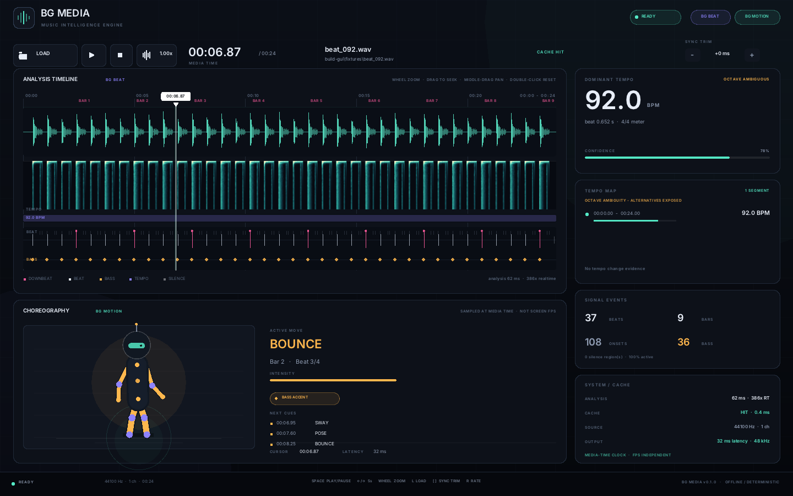

# BG Media

**Независимый кроссплатформенный C++20-движок музыкального анализа и
синхронизации анимаций.** Не визуализатор громкости: BG Media сначала строит
карту музыки — темп, фазы ударов, сильные доли, басовые акценты, тишину — и
только потом отдаёт её хореографии.



Текущий этап — полностью рабочий музыкальный анализатор и Desktop-приложение.
Телеграм-интеграции, сервера, видео и 3D-модели здесь намеренно нет.

## Что уже работает

- WAV / MP3 / FLAC, выбор файла, drag-and-drop, воспроизведение, пауза,
  перемотка, скорость 0.75×/1.00×/1.25×.
- Waveform, спектрограмма, onset-события, карта ударов, downbeat/bar,
  басовые акценты и регионы тишины на общем timeline.
- BPM с confidence, альтернативами и явной отметкой октавной
  неоднозначности (половинный/двойной темп).
- Смена темпа: стабильные сегменты + отдельные **неуверенные** переходы;
  приложение не выдаёт предполагаемую смену за измеренный BPM.
- Курсор синхронизирован с реальным audible-временем с учётом задержки
  аудиовыхода; есть ручной sync trim.
- Анализ в фоновом потоке; UI не зависает, прогресс и отмена поддерживаются.
- Кеш результатов по fingerprint PCM + конфигурации; попадание в кеш
  занимает доли миллисекунды.
- Детерминированная хореография в media time (BG Motion), независимая от FPS,
  с 2D-роботом в качестве одного из возможных рендереров.
- Headless CLI, генератор синтетических тестов, CTest и benchmark.

Измерения на синтетическом корпусе и 5-минутном треке:
**[docs/MEASUREMENTS.md](docs/MEASUREMENTS.md)**.
300-секундный трек анализируется ~**1.37 с** (медиана, ~**219× realtime**) на
Ryzen 7 5700X. Точность BPM на 92/123/163 BPM — в пределах долей BPM;
beat recall 1.00 при допуске 60 мс на стабильных треках (0.93 на переходе
92→123, где часть ударов попадает в неуверенную transition-зону).

## Быстрый старт: Windows

Нужны Visual Studio 2022/2026 с C++ Desktop workload, CMake 3.24+ и Ninja.
Самый простой путь — скрипт, который найдёт VS через `vswhere`, настроит
окружение и соберёт всё:

```powershell
powershell -ExecutionPolicy Bypass -File scripts/build_windows.ps1
```

Результат:

```text
build/windows/bin/bgmedia_desktop.exe
build/windows/bin/bgmedia_analyze.exe
build/windows/bin/bgmedia_benchmark.exe
build/windows/bin/bgmedia_fixturegen.exe
build/windows/bin/bgmedia_tests.exe
```

Запуск:

```powershell
build\windows\bin\bgmedia_desktop.exe
```

Или вручную из **x64 Native Tools Command Prompt for VS**:

```bat
cmake -S . -B build\windows -G Ninja ^
  -DCMAKE_BUILD_TYPE=Release ^
  -DBGMEDIA_BUILD_DESKTOP=ON ^
  -DBGMEDIA_BUILD_TESTS=ON ^
  -DBGMEDIA_BUILD_TOOLS=ON ^
  -DBGMEDIA_BUILD_MINIAUDIO=ON
cmake --build build\windows --parallel
ctest --test-dir build\windows --output-on-failure
```

Первый configure скачивает закреплённый SDL3 3.4.18 через `FetchContent`
(нужен интернет один раз для сборки). Само приложение сетевых запросов не
делает. Если SDL3 уже установлен, CMake найдёт его через `SDL3_DIR`; для
полностью офлайн-сборки передайте `-DBGMEDIA_FETCH_SDL3=OFF`.

## Быстрый старт: Linux

Зависимости (Debian/Ubuntu-пример):

```bash
sudo apt install build-essential cmake ninja-build \
  libx11-dev libxext-dev libwayland-dev libxkbcommon-dev libdecor-0-dev
```

```bash
chmod +x scripts/build_linux.sh
./scripts/build_linux.sh
```

Или вручную:

```bash
cmake -S . -B build/linux -G Ninja \
  -DCMAKE_BUILD_TYPE=Release \
  -DBGMEDIA_BUILD_DESKTOP=ON \
  -DBGMEDIA_BUILD_TESTS=ON \
  -DBGMEDIA_BUILD_TOOLS=ON
cmake --build build/linux --parallel
ctest --test-dir build/linux --output-on-failure
./build/linux/bin/bgmedia_desktop
```

`assets/` копируется рядом с исполняемым файлом на этапе сборки. При ручной
раскладке приложения папку `assets/` нужно положить рядом с бинарником.

### Presets

Если CMake и компилятор уже в окружении:

```bash
cmake --preset release
cmake --build --preset release
ctest --preset release
```

Есть также `core-only` (сборка только библиотеки/CLI без SDL) и `debug`.

## Управление Desktop

| Действие | Клавиша / мышь |
|---|---|
| выбрать файл | `L`, `Ctrl+O`, кнопка **LOAD**, drag-and-drop |
| play / pause | `Space` |
| перемотка ±5 с / ±30 с | `←` / `→`, с `Shift` — ±30 с |
| начало / конец | `Home` / `End` |
| скорость | `R` или кнопка с `×` |
| sync trim ±5 мс | `[` / `]` |
| зум timeline | колесо мыши |
| панорама | средняя кнопка + drag |
| scrub | левая кнопка + drag по timeline |
| сброс зума | double-click по timeline |
| fullscreen | `F` |
| выход из fullscreen | `Esc` |

Кнопки выбора файла, play/pause, stop, rate и sync trim также кликабельны.
Курсор показывает audible media time, а не позицию чтения декодера: задержка
устройства вычитается через `BG Sync`, с возможностью ручной коррекции.

## Headless CLI

Сгенерировать детерминированные тестовые WAV (92/123/163 BPM, смена темпа,
тишина, басы, неоднозначный ритм, 5-минутный трек с `--long`):

```bash
build/linux/bin/bgmedia_fixturegen fixtures --long
```

Анализ без GUI:

```bash
build/linux/bin/bgmedia_analyze fixtures/beat_092.wav \
  --cache-dir .bgmedia_cache --json -
```

Повторный запуск покажет `cache: hit`. Для замеров:

```bash
build/linux/bin/bgmedia_analyze fixtures/beat_092.wav --no-cache --repeat 5
```

Единый quality/speed benchmark:

```bash
build/linux/bin/bgmedia_benchmark --json docs/benchmark.json
```

Он проверяет синтетический корпус, считает BPM-ошибку, beat precision/recall,
среднюю ошибку времени, время анализа, realtime factor, 5-минутный трек и
скорость записи/чтения кеша.

### Скриншоты без GUI-сессии

```bash
bgmedia_desktop --file fixtures/beat_092.wav \
  --capture docs/images/shot.bmp --capture-time 5.2
```

`--audio-smoke` вместе с `--capture` дополнительно инициализирует реальный
аудиовыход, проигрывает/паузит/перематывает трек, проверяет скорость и печатает
измеренную позицию и latency. Это удобно для smoke-проверки драйвера.

## Тесты

```bash
ctest --test-dir build/windows --output-on-failure
# или
build/windows/bin/bgmedia_tests.exe
```

25 тестов, разбитые на CTest-группы:

- `audio` — WAV PCM/float, 24-bit, truncated files, MP3/FLAC/WAV через
  miniaudio, downmix/hash;
- `analysis` — 92/123/163 BPM, beat alignment, tempo change, silence,
  fully silent, bass vs broadband swell, ambiguous rhythm, cancellation;
- `cache` — roundtrip, corruption, version mismatch, key mismatch, atomic store;
- `sync` — latency compensation, pause/seek/rate, clamping, monotonic smoothing;
- `choreography` — cues, freezes, deterministic sampling, empty input.

Тестовые аудиофайлы — оригинальные синтетические сигналы; см.
[tests/fixtures/README.md](tests/fixtures/README.md).

## Структура репозитория

```text
include/bgmedia/            публичные заголовки core
src/audio/                  PCM, WAV decoder
src/analysis/               STFT, onset, tempo, beat DP, bass, silence
src/cache/                  версионированный бинарный кеш
src/sync/                   TransportSnapshot + PlaybackClock
src/choreography/           cues/poses/media-time sampling
adapters/miniaudio/         MP3/FLAC/WAV decode adapter
apps/desktop/               SDL3 UI, miniaudio playback, screenshot/audio smoke
tools/analyze/              headless JSON CLI
tools/fixturegen/           генератор синтетики
tools/benchmark/            качество + скорость + кеш
tests/                      CTest + синтетические фикстуры
docs/ARCHITECTURE.md        архитектура и точки расширения (включая BG Video)
docs/ANDROID_JNI.md         конкретный план Android/JNI
docs/MEASUREMENTS.md        реальные замеры
docs/images/                скриншоты
third_party/                KissFFT, miniaudio, stb_truetype, лицензии
```

Публичный umbrella-заголовок — `include/bgmedia/bgmedia.hpp`.

## Архитектура коротко

```text
host app (SDL3 / Android / ...)
   │  IPlaybackController / IAudioDecoder / ICharacterPresenter
   ▼
bgmedia_core
   ├── BG Beat   : анализ PCM → BPM, beats, bass, silence, sections
   ├── BG Sync   : media time, latency, seek/rate, smoothing
   ├── BG Motion : choreography cues/poses без SDL
   └── cache     : content+config key, checksum, schema version
```

- Core не знает SDL, miniaudio, Telegram, Android и звуковую карту.
- Декодер и плеер — взаимозаменяемые адаптеры.
- Анализ принимает PCM, поэтому WAV/MP3/FLAC/MediaCodec равноправны.
- Общая модель времени подходит для будущего видео: audio-master clock,
  presentation timestamps, те же seek/pause/rate/latency.
- Видео, эффекты и Android пока не реализованы, но точки расширения и JNI-план
  зафиксированы. См. [docs/ARCHITECTURE.md](docs/ARCHITECTURE.md) и
  [docs/ANDROID_JNI.md](docs/ANDROID_JNI.md).

### Минимальный API

```cpp
#include <bgmedia/bgmedia.hpp>
#include <bgmedia/audio/MiniaudioDecoder.hpp>

bgmedia::MiniaudioDecoder decoder;             // WAV/MP3/FLAC
auto decoded = decoder.decode("track.flac");
auto pcm = bgmedia::PcmBuffer::fromAudio(decoded.audio);

bgmedia::Analyzer analyzer;
auto report = analyzer.analyze(pcm, [](float p, const std::string& stage) {
    // progress
});
if (!report.ok()) { /* report.message */ }

const auto& a = report.result;
// a.bpm, a.bpmConfidence, a.beats, a.bassAccents, a.tempoSegments,
// a.tempoTransitions, a.silences, a.spectrogram
```

## Ограничения этапа

- Моно-анализ; стерео-панорама не учитывается.
- Темп-приор ~120 BPM может ошибаться на экзотических ритмах; альтернативы и
  `octaveAmbiguous` всегда доступны.
- Смена темпа показывается как возможная (`TempoTransition`), а не как
  доказанный факт.
- Meter/downbeat — эвристика; confidence низкая на равномерном пульсе.
- Скорость в демо меняет питч (линейный resampler), это не time-stretch.
- Задержка вывода оценивается по периодам устройства; есть ручной trim.
- In-memory decoder ограничен 1 GiB; очень длинные файлы — следующий этап.
- Android/iOS, BG Video, BG Effects и BeyGram ещё не подключены.

## Лицензии

Код BG Media — MIT, см. [LICENSE](LICENSE). Сторонние компоненты:

- SDL3 — zlib license (используется только desktop-приложением);
- miniaudio — public domain / MIT-0 (decode + desktop playback);
- KissFFT — BSD-3-Clause (компилируется внутрь core);
- stb_truetype — MIT / public domain (растеризация шрифта в desktop);
- Inter — SIL Open Font License (UI-шрифт).

Тексты лицензий: `third_party/licenses/` и `assets/fonts/Inter-LICENSE.txt`.
