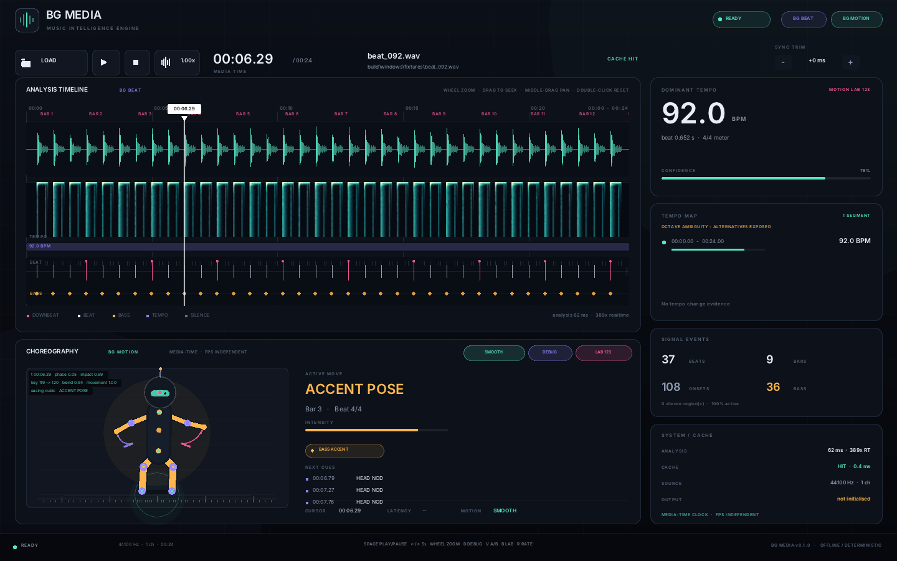
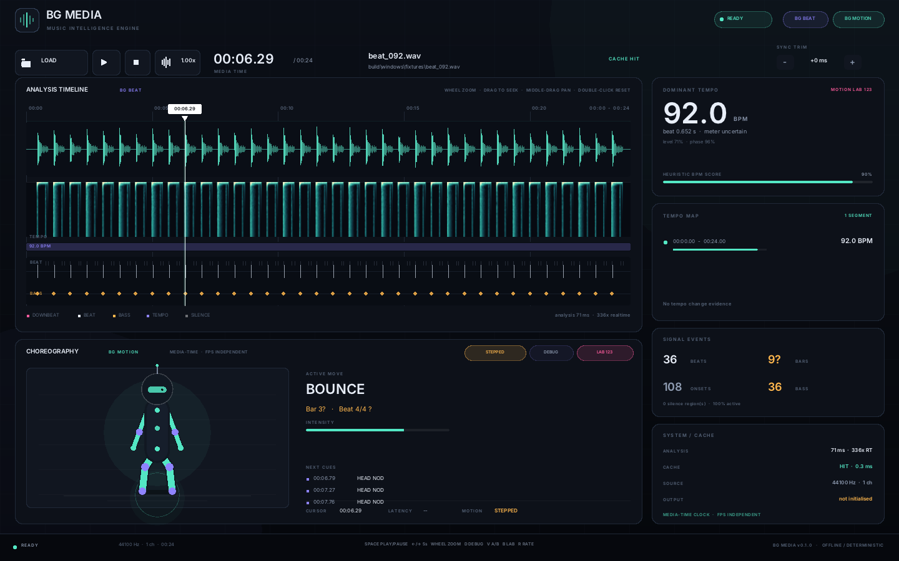
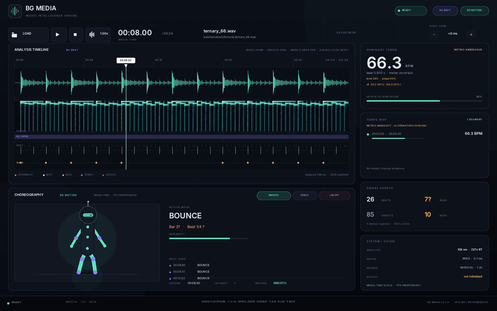
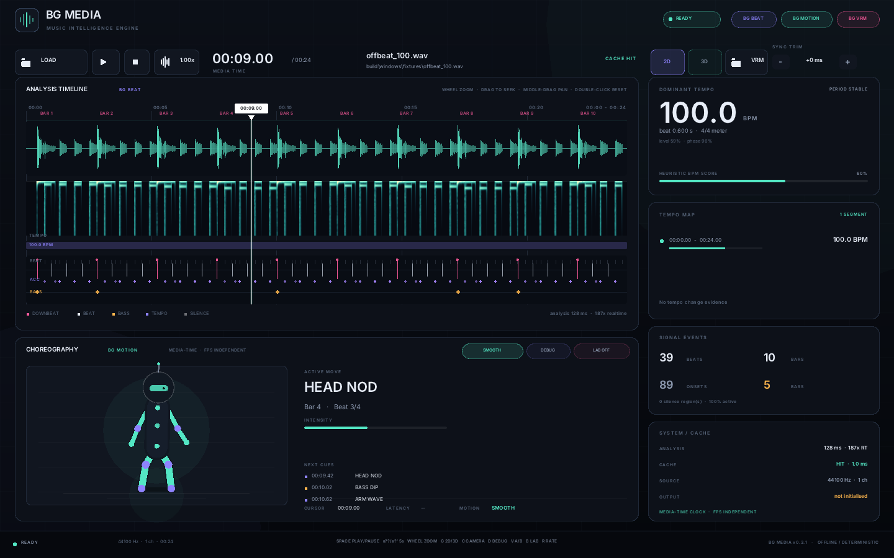

# BG Media

**Независимый кроссплатформенный C++20-движок музыкального анализа и
синхронизации анимаций.** Не визуализатор громкости: BG Media сначала строит
карту музыки — темп, фазы ударов, сильные доли, басовые акценты, тишину — и
только потом отдаёт её хореографии.


BG Motion 2.0 в debug-режиме (Motion Lab 123 BPM, smooth sampling). Рядом —
тот же момент в старом ступенчатом режиме (`V` / `--motion-stepped`):





BG Motion 3.1 играет авторские танцевальные клипы на VRM: Groove, Hip-Hop,
Side Step и Energetic, с переходами по музыкальным beats и downbeat-фразам.
Скриншот сцены с `Model1.vrm` не добавлен в Git из-за лицензии модели;
локальные кадры лежат в `artifacts/` (игнорируется). Формат клипов,
хореография и QA описаны в [docs/BG_MOTION_3.md](docs/BG_MOTION_3.md), а
музыкальная синхронизация 3.1 — в
[docs/BG_MOTION_3_1.md](docs/BG_MOTION_3_1.md).

Честная метрическая неоднозначность на 12/8-стимуле: выбран пульс 66.3 BPM,
но UI показывает альтернативы 99.2/198.9 и `meter uncertain`:



Текущий этап — рабочий музыкальный анализатор, **BG Motion 3.1** и
**BG Media 3D**: настоящая VRM 0.x-модель в SDL_GPU-сцене, humanoid-скелет,
retargeting авторских танцевальных клипов и синхронизация с плеером.
Телеграм-интеграции, сервера и видео здесь по-прежнему нет.

Скриншот 3D-персонажа намеренно не добавлен в Git: модель имеет лицензию
`OnlyAuthor` / `Redistribution_Prohibited`. Локальная проверка работающего
Desktop во время воспроизведения музыки сохраняется в
`artifacts/desktop3d_playing.png` (см. `docs/VRM_INTEGRATION.md`).

## Что уже работает

- WAV / MP3 / FLAC, выбор файла, drag-and-drop, воспроизведение, пауза,
  перемотка, скорость 0.75×/1.00×/1.25×.
- Waveform, спектрограмма, onset-события, карта ударов, downbeat/bar,
  басовые акценты и регионы тишины на общем timeline.
- BPM с **эвристическим** confidence, альтернативами и явной отметкой
  метрической неоднозначности (2:1, 3:1, 3:2, 4:3); уровень пульса оценивается
  отдельно от его периодичности.
- Смена темпа: стабильные сегменты + отдельные **неуверенные** переходы;
  приложение не выдаёт предполагаемую смену за измеренный BPM.
- Курсор синхронизирован с реальным audible-временем с учётом задержки
  аудиовыхода; есть ручной sync trim.
- Анализ в фоновом потоке; UI не зависает, прогресс и отмена поддерживаются.
- Кеш результатов по fingerprint PCM + конфигурации; попадание в кеш
  занимает доли миллисекунды.
- **BG Motion 2.0:** непрерывный keyframe-таймлайн, кубическая интерполяция,
  short-arc повороты, anticipation/release, кроссфейд движений, адаптация
  амплитуды на быстром темпе и точное попадание акцентной позы в удар.
- Шесть танцевальных движений BG Motion 2.0: Bounce, Sway, Arm Wave, Head Nod,
  Bass Dip, Accent Pose; тела/руки/голова/ноги движутся согласованно.
- **BG Motion 3.0:** четыре авторских танца — Groove, Hip-Hop, Side Step,
  Energetic — плюс Idle. Клипы хранятся как model-independent JSON, играют от
  музыкальных beats, а не от таймера, и переходят друг в друга на entry beat
  через двухбитовый crossfade.
- **BG Motion 3.1:** `MusicalTimeline` с beat/bar/downbeat confidence,
  реальной картой onset/bass акцентов, субдолями и 6/8–12/8 compound feel;
  начало танца и Auto-фразы выравниваются по downbeat только при достаточной
  уверенности. Добавлен ограниченный C1 time warp `Off/Soft/Expressive`
  (верхняя часть тела по умолчанию), который не двигает root/hips/цели стоп и
  не смещает акцентную позу с beat. Диагностика показывает beat/bar, local BPM,
  downbeat confidence, accent/bass, warp phase/rate и alignment error; профиль
  сохраняется в `motion-profile.cfg`.


- Footwork хранится как stage-space цели стоп с контактами `stance`/`pivot`:
  опорная стопа не скользит, поворот идёт вокруг неё, IK сам опускает таз,
  если широкая стойка недостижима. Root motion ограничен и не уводит камеру.
- Manual/Auto режимы: ручной выбор стиля на следующий beat или Auto-план по
  фразам, энергии секций, басовым акцентам и тишине; low-confidence BG Beat
  остаётся на стабильном Groove.
- Presentation mode (`P` / `--presentation`), debug-виды foot contact,
  skeleton и root motion, CLI `--dance`, `--dance-plan`, `--dance-bpm`,
  `--legacy-motion` для A/B с BG Motion 2.0.
- Demo-режимы: **SMOOTH / STEPPED** (`V`), **DEBUG** (`D`) с суставами,
  траекториями и keyframe-диагностикой, **MOTION LAB** (`B`) с синтетической
  beat-сеткой 92/123/163/180 BPM независимо от ошибок анализатора.
- **BG Media 3D:** импорт настоящего VRM 0.x (GLB), 175 узлов, 54 humanoid
  кости, 35 881 треугольник, 15 материалов и 15 встроенных base-color текстур;
  человеческая модель, а не манекен.
- Отдельный `bgmedia_vrm` (загрузчик) и `bgmedia_rig` (retargeting) без SDL;
  `bgmedia_sdlgpu` — независимый SDL_GPU offscreen-рендерер с depth buffer,
  skinning, alpha mask/blend, mip-текстурами и камерой. Композитинг в
  существующий SDL_Renderer UI, без совместного владения GPU-контекстом.
- 3D-режим: орбита/zoom/reset камеры, масштаб и высота модели, выбор `.vrm`,
  диагностика импорта, текущий трек/движение/BG Sync/FPS/GPU ms/VRAM/RSS.
  Без музыки танцы идут от Motion Lab BPM; с музыкой — от BG Beat/BG Sync.
- Детерминированный humanoid retargeting с quaternion-иерархией, base pose
  без T-pose, two-bone IK с неподвижными стопами и generic привязкой по
  VRM humanoid, без индексов конкретной модели.
- Headless CLI, генератор синтетических тестов, CTest, ASan-прогон и benchmark.

Измерения на синтетическом корпусе и 5-минутном треке:
**[docs/MEASUREMENTS.md](docs/MEASUREMENTS.md)**.
300-секундный трек анализируется ~**1.52–1.75 с** (медиана 1.65 с, ~**171–196× realtime**) на
Ryzen 7 5700X. Точность BPM на 92/123/163 BPM — в пределах долей BPM;
beat recall 1.00 при допуске 60 мс, средняя ошибка времени 2–4 мс. На
21-сценарном корпусе 3.1 beat F1 **0.9837**, downbeat F1 **0.9406**,
meter 21/21; см. [docs/BG_MOTION_3_1.md](docs/BG_MOTION_3_1.md).

## Быстрый старт: Windows

Нужны Visual Studio 2022/2026 с C++ Desktop workload, CMake 3.24+ и Ninja.
Самый простой путь — скрипт, который найдёт VS через `vswhere`, настроит
окружение и соберёт всё:

```powershell
powershell -ExecutionPolicy Bypass -File scripts/build_windows.ps1
```

Результат:

```text
build/windows/bin/bgmedia_desktop.exe
build/windows/bin/bgmedia_analyze.exe
build/windows/bin/bgmedia_benchmark.exe
build/windows/bin/bgmedia_fixturegen.exe
build/windows/bin/bgmedia_tests.exe
build/windows/bin/bgmedia_motion_qa.exe
build/windows/bin/bgmedia_motion_sheet.exe
```

Запуск:

```powershell
build\windows\bin\bgmedia_desktop.exe
```

Или вручную из **x64 Native Tools Command Prompt for VS**:

```bat
cmake -S . -B build\windows -G Ninja ^
  -DCMAKE_BUILD_TYPE=Release ^
  -DBGMEDIA_BUILD_DESKTOP=ON ^
  -DBGMEDIA_BUILD_TESTS=ON ^
  -DBGMEDIA_BUILD_TOOLS=ON ^
  -DBGMEDIA_BUILD_MINIAUDIO=ON
cmake --build build\windows --parallel
ctest --test-dir build\windows --output-on-failure
```

Первый configure скачивает закреплённый SDL3 3.4.18 через `FetchContent`
(нужен интернет один раз для сборки). Само приложение сетевых запросов не
делает. Если SDL3 уже установлен, CMake найдёт его через `SDL3_DIR`; для
полностью офлайн-сборки передайте `-DBGMEDIA_FETCH_SDL3=OFF`.

## Быстрый старт: Linux

Зависимости (Debian/Ubuntu-пример):

```bash
sudo apt install build-essential cmake ninja-build \
  libx11-dev libxext-dev libwayland-dev libxkbcommon-dev libdecor-0-dev
```

```bash
chmod +x scripts/build_linux.sh
./scripts/build_linux.sh
```

Или вручную:

```bash
cmake -S . -B build/linux -G Ninja \
  -DCMAKE_BUILD_TYPE=Release \
  -DBGMEDIA_BUILD_DESKTOP=ON \
  -DBGMEDIA_BUILD_TESTS=ON \
  -DBGMEDIA_BUILD_TOOLS=ON
cmake --build build/linux --parallel
ctest --test-dir build/linux --output-on-failure
./build/linux/bin/bgmedia_desktop
```

`assets/` копируется рядом с исполняемым файлом на этапе сборки. При ручной
раскладке приложения папку `assets/` нужно положить рядом с бинарником.

### Presets

Если CMake и компилятор уже в окружении:

```bash
cmake --preset release
cmake --build --preset release
ctest --preset release
```

Есть также `core-only` (сборка только библиотеки/CLI без SDL) и `debug`.

## Управление Desktop

| Действие | Клавиша / мышь |
|---|---|
| выбрать файл | `L`, `Ctrl+O`, кнопка **LOAD**, drag-and-drop |
| play / pause | `Space` |
| перемотка ±5 с / ±30 с | `←` / `→`, с `Shift` — ±30 с |
| начало / конец | `Home` / `End` |
| скорость | `R` или кнопка с `×` |
| smooth / stepped сравнение | `V` или chip **SMOOTH/STEPPED** |
| motion debug: суставы, траектории, keyframes | `D` или chip **DEBUG** |
| Motion Lab BPM | `B` или chip **LAB** |
| 2D robot / 3D VRM | `2` / `3`, `G`, chips **2D/3D** |
| выбрать VRM | `F2`, кнопка **VRM**, drag-and-drop `.vrm`/`.glb` |
| 3D-камера: орбита / zoom / reset | ЛКМ + drag / колесо / `C` |
| масштаб / высота 3D-модели | `-`/`+` · `,`/`.` или кнопки в панели |
| BG Motion 3.1: Groove / Hip-Hop / Side Step / Energetic | `1` / `2` / `3` / `4` (в 3D) |
| BG Motion 3.1: Idle | `0` или `5` (в 3D) |
| Manual / Auto | `A` или **MANUAL/AUTO** |
| Loop / one-shot | `N` или **LOOP/ONE SHOT** |
| TEST DANCE: все стили подряд | `T` или **TEST DANCE** |
| Presentation mode | `P` или **PRESENT** |
| foot contact / skeleton / root debug | `F5` / `F6` / `F7` |
| музыкальная диагностика (beat/bar, warp, accent) | `M` |
| Off / Soft / Expressive warp | `E` или кнопка **EXPR** |
| BPM Motion Lab | `↑` / `↓` (с `Shift` — по 10) |
| синтетический танец BG Motion 2.0 без музыки | `T` вне 3D-танцев |
| sync trim ±5 мс | `[` / `]` |
| зум timeline | колесо мыши |
| панорама | средняя кнопка + drag |
| scrub | левая кнопка + drag по timeline |
| сброс зума | double-click по timeline |
| fullscreen | `F` |
| выход из fullscreen | `Esc` |

Кнопки выбора файла, play/pause, stop, rate и sync trim также кликабельны.
Курсор показывает audible media time, а не позицию чтения декодера: задержка
устройства вычитается через `BG Sync`, с возможностью ручной коррекции.
В 3D-режиме с загруженными танцами клавиши `1`–`4` переключают стили
BG Motion 3.0; для 2D/3D используйте `G` или chips **2D/3D**.

## Headless CLI

Сгенерировать детерминированные тестовые WAV (92/123/163 BPM, смена темпа,
тишина, басы, неоднозначный ритм, 5-минутный трек с `--long`):

```bash
build/linux/bin/bgmedia_fixturegen fixtures --long
```

Анализ без GUI:

```bash
build/linux/bin/bgmedia_analyze fixtures/beat_092.wav \
  --cache-dir .bgmedia_cache --json -
```

Повторный запуск покажет `cache: hit`. Для замеров:

```bash
build/linux/bin/bgmedia_analyze fixtures/beat_092.wav --no-cache --repeat 5
```

Единый quality/speed benchmark:

```bash
build/linux/bin/bgmedia_benchmark --json docs/benchmark.json
```

Он проверяет синтетический корпус, считает BPM-ошибку, beat precision/recall,
среднюю ошибку времени, время анализа, realtime factor, 5-минутный трек и
скорость записи/чтения кеша.

### Скриншоты без GUI-сессии

```bash
bgmedia_desktop --file fixtures/beat_092.wav \
  --capture docs/images/shot.bmp --capture-time 5.2
```

`--audio-smoke` вместе с `--capture` дополнительно инициализирует реальный
аудиовыход, проигрывает/паузит/перематывает трек, проверяет скорость и печатает
измеренную позицию и latency. Это удобно для smoke-проверки драйвера.

Снимок нового motion-движка без зависимости от результата BG Beat:

```bash
bgmedia_desktop --file fixtures/beat_092.wav \
  --capture motion.bmp --capture-time 5.2 \
  --motion-lab 123 --motion-debug --no-audio
```

`--motion-stepped` включает старый ступенчатый сэмплер для A/B-сравнения.
Подробности модели и гарантий попадания в удар: [docs/MOTION.md](docs/MOTION.md).

3D-режим можно проверить без музыки и без окна:

```bash
bgmedia_desktop --vrm models/Model1.vrm --vrm-demo \
  --capture artifacts/vrm.bmp --capture-time 3.2 --no-audio
bgmedia_vrm_preview --model models/Model1.vrm --time 3.2 --out artifacts/preview.bmp
```

BG Motion 3.0 можно проверить в реальном Desktop-приложении детерминированно:
`--capture` запускает тот же exe, тот же retargeter и SDL_GPU, но сохраняет
один кадр. Например, переход Groove → Hip-Hop на 4-й секунде при 120 BPM:

```bash
bgmedia_desktop --vrm models/Model1.vrm --dance-plan groove,hiphop \
  --dance-span 8 --dance-bpm 120 --capture artifacts/groove_hiphop.bmp \
  --capture-time 3.9 --no-audio
```

Контактный лист и GIF по кадрам реального приложения:

```bash
python scripts/capture_dance_sequence.py --name groove_cycle \
  --args "--dance groove --dance-bpm 96" --times 0:10:20 --bpm 96 --gif
```

QA-метрики клипов:

```bash
bgmedia_motion_qa --dances assets/dances --model models/Model1.vrm
```

С реальным треком:

```bash
bgmedia_desktop --file track.mp3 --vrm models/Model1.vrm --3d --dance auto --autoplay
bgmedia_desktop --file track.mp3 --vrm models/Model1.vrm --3d --dance groove --autoplay
```

Флаг `--legacy-motion` включает в 3D старый BG Motion 2.0 `CharacterPose` для
A/B-сравнения. Полное описание BG Motion 3.0:
[docs/BG_MOTION_3.md](docs/BG_MOTION_3.md).

`Model1.vrm` не входит в репозиторий: лицензия `OnlyAuthor` /
`Redistribution_Prohibited`. Архитектура, поддерживаемые возможности,
ограничения и измерения: [docs/VRM_INTEGRATION.md](docs/VRM_INTEGRATION.md).

## Тесты

```bash
ctest --test-dir build/windows --output-on-failure
# или
build/windows/bin/bgmedia_tests.exe
```

115 тестов, разбитые на 12 CTest-групп:

- `audio` — WAV PCM/float, 24-bit, truncated files, MP3/FLAC/WAV через
  miniaudio, downmix/hash;
- `analysis` — straight 80/92/100/123/125/163 BPM, offbeat, 12/8 ternary
  66 BPM, half-time, shuffle, dense hats, syncopated bass, drift, tempo
  change, silence, bass vs broadband swell, ambiguous rhythm, cancellation,
  onset timestamp bias, 150/180 BPM, 6/8/12/8 и tempo ramp;
- `timeline` — beat phase invertibility, edge cases (empty/NaN/duplicate),
  downbeat confidence gating, accent timestamps, subdivision/compound,
  silence, tempo change;
- `warp` — C1 invariants, bounded rate, monotonicity, contact scale, random
  finiteness, profile round-trip, root/foot stability, retargeted slide,
  exact accent pose;
- `sync31` — downbeat alignment, low-confidence fallback, seek bar phase,
  tempo rebase, exact accent pose, silence warp-off, Auto phrase downbeats;
- `cache` — roundtrip, corruption, analyzer/format version mismatch, key
  mismatch, atomic store;
- `sync` — latency compensation, pause/seek/rate, clamping, monotonic smoothing;
- `choreography` — cues, freezes, deterministic sampling, empty input;
- `motion` — exact accent targets, continuous keyframes, 30/60/120 FPS and
  arbitrary-order determinism, easing/shortest-arc, pause/seek, tempo change,
  fast-tempo amplitude adaptation, offbeat-bass BassDip guard, smooth vs
  stepped comparison;
- `vrm` — GLB/VRM 0.x import, 54 humanoid bones, textures, truncation,
  malformed containers и 150 случайных мутаций;
- `retarget` — generic humanoid rig, neutral pose без T-pose, foot IK,
  артикуляция рук/головы/корпуса, побитовый deterministic sampling после
  seek/rewind и реальный Model1.vrm (если файл доступен);
- `dance` — загрузка/валидация `bgmotion.clip`, loop seam, ограниченные
  скорость и ускорение, footwork и отсутствие slide, повороты вокруг опорной
  стопы, 20 пар стилей при 80/123/180 BPM (60 переходов), seek/pause/resume,
  one-shot,
  metric levels 0.5/1/2, Manual entry beat, Auto-план и смена темпа.

ASan-прогон: `scripts/run_asan_windows.ps1` — dance-тесты входят в тот же
набор; результат фиксируется в `docs/MEASUREMENTS.md`.

Тестовые аудиофайлы — оригинальные синтетические сигналы; см.
[tests/fixtures/README.md](tests/fixtures/README.md). Подробный
до/после-разбор BG Beat: [docs/BG_BEAT_AUDIT.md](docs/BG_BEAT_AUDIT.md).

## Структура репозитория

```text
include/bgmedia/            публичные заголовки core, math, VRM, rig
src/audio/                  PCM, WAV decoder
src/analysis/               STFT, onset, tempo, beat DP, bass, silence
src/cache/                  версионированный бинарный кеш
src/sync/                   TransportSnapshot + PlaybackClock
src/choreography/           BG Motion 2.0 cues/poses/media-time sampling
src/motion3/                BG Motion 3.1 clips, BeatClock, timeline, warp, schedule
src/vrm/                    GLB/glTF + VRM 0.x importer, PNG decode
src/animation/              generic humanoid retargeter, clip IK, local transforms
adapters/miniaudio/         MP3/FLAC/WAV decode adapter
adapters/sdlgpu/            независимый SDL_GPU offscreen VRM renderer
apps/desktop/               SDL3 UI, 2D/3D compositor, miniaudio playback
tools/analyze/              headless JSON CLI
tools/fixturegen/           генератор синтетики
tools/vrm_preview/          headless 3D preview/test render
tools/motion_qa/            BG Motion 3.0/3.1 quality report
tools/sync_qa/              BG Motion 3.1 beat/meter/accent/warp QA corpus
tools/motion_sheet/         contact sheets on the real renderer
tools/dancegen/             Python DSL + deterministic dance baker
tools/benchmark/            качество + скорость + кеш
tests/                      CTest + synthetic VRM/audio fixtures
docs/ARCHITECTURE.md        архитектура и точки расширения (включая BG Video)
docs/VRM_INTEGRATION.md     VRM 0.x, SDL_GPU, retargeting, UI, замеры
docs/ANDROID_JNI.md         конкретный план Android/JNI
docs/MOTION.md              BG Motion 2.0: keyframes, blending, accents, debug
docs/BG_MOTION_3.md         BG Motion 3.0: clip format, footwork, transitions, QA
docs/BG_MOTION_3_1.md       BG Motion 3.1: musical timeline, accent map, warp, QA
docs/BG_BEAT_AUDIT.md       исправление метрического уровня, downbeat, UI, кеша
docs/MEASUREMENTS.md        реальные замеры
docs/images/                скриншоты 2D UI
third_party/                KissFFT, miniaudio, stb, cgltf, лицензии
```

Публичный umbrella-заголовок — `include/bgmedia/bgmedia.hpp`.

## Архитектура коротко

```text
host app (SDL3 / Android / ...)
   │  IPlaybackController / IAudioDecoder / ICharacterPresenter
   ▼
bgmedia_core
   ├── BG Beat   : анализ PCM → BPM, beats, bass, silence, sections
   ├── BG Sync   : media time, latency, seek/rate, smoothing
   ├── BG Motion 2.0 : choreography cues/poses без SDL
   ├── cache     : content+config key, checksum, schema version
   └── CharacterPose (нормализованный контракт для 2D/3D)

bgmedia_vrm (cgltf/stb_image, без SDL) → VrmModel/humanoid/bind pose
bgmedia_rig (без SDL) → BG Motion 3.1 DancePlayer
                       → MusicalTimeline + time warp → ClipPose
                       → local node transforms + foot IK
adapters/sdlgpu (SDL_GPU) → offscreen RGBA8 + D32 → UI SDL_Texture
```

- Core не знает SDL, miniaudio, Telegram, Android и звуковую карту.
- BG Beat/BG Sync и BG Motion 2.0 не знают SDL или GPU; BG Motion 3.0 хранит
  клипы в humanoid-пространстве и не зависит от индексов конкретной модели.
- Декодер и плеер — взаимозаменяемые адаптеры.
- Анализ принимает PCM, поэтому WAV/MP3/FLAC/MediaCodec равноправны.
- Общая модель времени подходит для будущего видео: audio-master clock,
  presentation timestamps, те же seek/pause/rate/latency.
- Видео и Android пока не реализованы, но точки расширения и JNI-план
  зафиксированы. См. [docs/ARCHITECTURE.md](docs/ARCHITECTURE.md) и
  [docs/ANDROID_JNI.md](docs/ANDROID_JNI.md).
- 3D: реальный VRM 0.x, skinning, MToon-подобные материалы, BG Motion и
  media-time синхронизация. См.
  [docs/VRM_INTEGRATION.md](docs/VRM_INTEGRATION.md).

### Минимальный API

```cpp
#include <bgmedia/bgmedia.hpp>
#include <bgmedia/audio/MiniaudioDecoder.hpp>

bgmedia::MiniaudioDecoder decoder;             // WAV/MP3/FLAC
auto decoded = decoder.decode("track.flac");
auto pcm = bgmedia::PcmBuffer::fromAudio(decoded.audio);

bgmedia::Analyzer analyzer;
auto report = analyzer.analyze(pcm, [](float p, const std::string& stage) {
    // progress
});
if (!report.ok()) { /* report.message */ }

const auto& a = report.result;
// a.bpm, a.bpmConfidence, a.bpmLevelConfidence, a.beatPhaseConfidence,
// a.downbeatConfidence, a.beats, a.bassAccents, a.tempoSegments,
// a.tempoTransitions, a.silences, a.spectrogram
```

## Ограничения этапа

- Моно-анализ; стерео-панорама не учитывается.
- `bpmConfidence`, `bpmLevelConfidence`, `beatPhaseConfidence` и
  `downbeatConfidence` — эвристические scores, **не вероятности**. Они не
  откалиброваны на большом размеченном корпусе.
- Метрическая неоднозначность (2:1, 3:1, 3:2, 4:3) остаётся видимой; UI не
  показывает `STABLE` как гарантию правильного музыкального темпа.
- Смена темпа показывается как возможная (`TempoTransition`), а не как
  доказанный факт.
- VRM 1.0, morph targets/blink, spring-bone физика и полный MToon (outline,
  sphere/rim maps, normal maps) в эту версию не входят; базовый VRM 0.x
  humanoid, текстуры, alpha и скелетная анимация работают.
- BG Motion 3.0 — авторская keyframe-хореография, не motion capture. Переход
  смешивает позиции стоп, поэтому на смене широкой и узкой стойки возможен
  короткий контролируемый slide; floor collision, лестниц и физических
  прыжков нет. Auto не угадывает стиль при низком confidence BG Beat.
- BG Motion 3.1: time warp по умолчанию только верхняя часть тела; нет
  отдельных фаз для рук/головы/secondary motion, floor collision и
  нескольких опор. Offbeat-100 synthetic имеет ~28 мс phase bias, dense hats
  160 остаётся half-time на уровне анализа (хореография использует rate 2×).
  Predicted accent time — не измеренная задержка монитора. Подробно:
  [docs/BG_MOTION_3_1.md](docs/BG_MOTION_3_1.md).
- Meter/downbeat — эвристика. При низкой `meterConfidence` UI скрывает
  downbeat-акценты и пишет `meter uncertain`.
- Реальные треки проверялись локально, но их эталонный BPM неизвестен; см.
  `docs/BG_BEAT_AUDIT.md`.
- Скорость в демо меняет питч (линейный resampler), это не time-stretch.
- Задержка вывода оценивается по периодам устройства; есть ручной trim.
- In-memory decoder ограничен 1 GiB; очень длинные файлы — следующий этап.
- Android/iOS, BG Video, BG Effects и BeyGram ещё не подключены.

## Лицензии

Код BG Media — MIT, см. [LICENSE](LICENSE). Сторонние компоненты:

- SDL3 — zlib license (используется только desktop-приложением);
- miniaudio — public domain / MIT-0 (decode + desktop playback);
- KissFFT — BSD-3-Clause (компилируется внутрь core);
- stb_truetype — MIT / public domain (растеризация шрифта в desktop);
- Inter — SIL Open Font License (UI-шрифт).

Тексты лицензий: `third_party/licenses/` и `assets/fonts/Inter-LICENSE.txt`.


## BG Motion 3.2 — procedural choreography и character dynamics

Версия 3.2 сохраняет musical timeline, BeatClock, accent map и time warp из
3.1 и добавляет:

- процедурный генератор полноценных танцев `Motif → Phrase → Section → Full Dance`
  (три детерминированных танца по 32 бита: Neon Pulse, Street Current,
  Fluid Signal);
- библиотеку из 27 motion primitives (руки, кисти, корпус, плечи, голова,
  footwork) и compositor с масками, приоритетами, joint limits и защитой
  контакта стопы;
- детальную анимацию пальцев VRM 0.x (30 костей у тестовой модели) с честным
  fallback при их отсутствии;
- VRM 0.x secondary animation: 36 spring chains, 116 spring bones, 22 collider
  сферы у тестовой модели, фиксированный timestep 120 Гц, damping, collision,
  reset при seek;
- Desktop-переключатели `LAYER`, `GEN`, `SPRING`, диагностику слоёв и spring
  chains;
- `docs/BG_MOTION_3_2.md`, `docs/motion_qa_3_2.txt` и
  `docs/motion_qa_3_2.json`.

Новые команды:

```powershell
build/windows/bin/bgmedia_procedural_dance.exe
build/windows/bin/bgmedia_motion_qa.exe --dances assets/dances ^
  --model models/Model1.vrm --json docs/motion_qa_3_2.json
build/windows/bin/bgmedia_desktop.exe --vrm models/Model1.vrm --3d ^
  --dance neonPulse --dance-bpm 104 --debug-skeleton
```

Полное описание, ограничения и измеренные результаты — в
`docs/BG_MOTION_3_2.md`.
