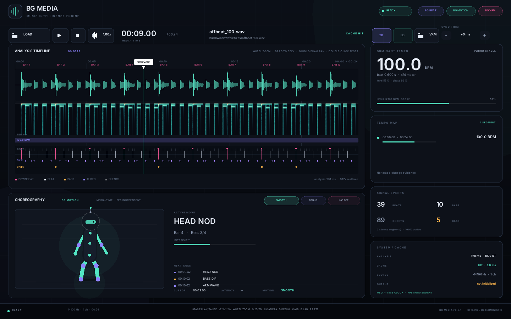

# BG Motion 3.1 — музыкальная синхронизация

BG Motion 3.1 — реализованный слой поверх BG Motion 3.0. Задача этапа: связать
танец не с «выбранным BPM», а с фактическими музыкальными событиями BG Beat —
ударами, сильными долями, размером, басовыми акцентами, субдолями и границами
фраз, сохранив устойчивость стоп и естественность движения.

Это инженерный отчёт и одновременно документация API. Всё, что описано ниже,
реализовано и проверено в текущем дереве; запланированные вещи вынесены в
раздел «Ограничения» и «Дальше».

- Исходный commit: `fd730fe` (BG Motion 3.0).
- Ветка: `feat/bg-motion-3.1-musical-sync`.
- Тесты: **115 passed, 0 failed** (12 CTest-групп).
- Измерения: `docs/sync_qa_3_1.json`, `docs/motion_qa_3_1.txt`,
  `docs/benchmark.json`.



---

## 1. Что изменилось

| Слой | 3.0 | 3.1 |
|---|---|---|
| Музыкальное время | `BeatClock` (сглаженная сетка) | `BeatClock` + `MusicalTimeline` |
| Фаза удара | по сглаженным временам | по реальным/сглаженным временам с защитой от NaN, дублей, seek и пустой карты |
| Метр | голосование `beatInBar` | contrast-оценка метра + явная confidence + fallback на beat |
| Downbeat | всегда использовался | используется только при `downbeatTrusted()`; иначе beat-level |
| Акценты | onsets и bass на timeline | `AccentEvent` с реальными timestamps, силой, confidence, downbeat/bass flags |
| Субдоли | не моделировались | 2/3/4-субдоли, 6/8 и 12/8 как compound feel |
| Начало танца | следующий entry beat | следующий downbeat, если он достоверен; иначе entry beat |
| Смена стиля | entry beat | entry beat на downbeat/фразе; Auto — по фразам |
| Скорость клипа | 0.5 / 1 / 2 | 0.5 / 1 / 2 + мягкий range penalty и MusicalTimeWarp |
| Time warp | нет | ограниченная C1-модуляция внутри beat, только верхняя часть тела по умолчанию |
| Акцентная поза | на beat | на beat без смещения; warp готовит к ней, но не двигает её |
| Стопы | IK и контакты | те же цели стоп; warp не меняет root/hips/foot targets |
| Диагностика | фаза клипа, скорость | + beat/bar, local BPM, downbeat confidence, accent, bass, warp phase/rate, alignment error |
| Настройки | нет | профиль `off / soft / expressive`, сохраняется в `motion-profile.cfg` |

Новые файлы:

```text
include/bgmedia/motion3/BeatClock.hpp
include/bgmedia/motion3/MusicalTimeline.hpp
include/bgmedia/motion3/MusicalTimeWarp.hpp
src/motion3/BeatClock.cpp
src/motion3/MusicalTimeline.cpp
src/motion3/MusicalTimeWarp.cpp
```

`BeatClock` вынесен из `DanceDirector.hpp` в отдельный заголовок, чтобы
`MusicalTimeline` и тесты не зависели от планировщика. Публичные типы
`DanceDirector`/`DancePlayer` расширены с обратной совместимостью: старые
вызовы `sample(time, clock)` и `setBeatClock()` работают.

---

## 2. Четыре уровня времени

BG Motion 3.1 явно разделяет четыре понятия; ошибка одного уровня не обязана
разрушать остальные.

```text
A. Audio timeline        audible media time из BG Sync / PlaybackClock
        │
B. Musical timeline      BeatClock + meter + downbeat + accents + bass
        │
C. Choreography timeline DanceSchedule: clip, entry beat, rate, phrase, transition
        │
D. Animation sampling    ClipPose → retargeting → foot IK → root → renderer
```

- **A** — единственный мастер-таймер. Рендер-кадры и накопленный `deltaTime` не
  являются музыкальным временем.
- **B** — `MusicalTimeline`; отдаёт `beatAt`, `barAt`, `beatInBarAt`,
  `downbeatAt`, `accentAt`, `bassAt`, `nextDownbeatTime`, `silenceWeightAt`.
- **C** — `DanceSchedule`; чистая функция media time. Crossfade — часть
  расписания, а не скрытое состояние.
- **D** — `ClipPose`; time warp применяется до сэмплирования, но root, hips и
  цели стоп остаются на устойчивой сетке.

---

## 3. Музыкальная временная шкала

### 3.1 Beat phase

`BeatClock` интерполирует **реальные времена соседних ударов**, а не постоянный
BPM:

```text
phase(t) = i + (t - beats[i]) / (beats[i+1] - beats[i])
```

Свойства:

- до первого удара — экстраполяция `headPeriod`, после последнего —
  `tailPeriod`;
- пустая карта — константная сетка от `bpm`;
- NaN/Inf, отрицательные, неупорядоченные и дублирующиеся timestamps
  отбрасываются/сортируются до fit;
- gap ограничен 64 слотами, `slotCount` ограничен 200 000;
- деление на нулевой интервал невозможно: минимум 1e-6, затем fallback;
- `timeAtBeat(beatAt(t)) == t` на всём диапазоне (проверяется тестом);
- `bpmAt` ограничен 20..400 BPM;
- `phaseAt` всегда 0..1; `beatPeriodAt` ≥ 0.02 с.

`BeatClock::fromAnalysis()` по-прежнему сглаживает сетку (глобальный fit при
стабильном темпе, локальный — при смене), потому что сырые onset timestamps
могут дрожать. Сглаживание не заменяет реальные события: `MusicalTimeline`
хранит их отдельно в accent map.

### 3.2 Метр и downbeat

`BeatTracker` оценивает кандидатов 2/3/4 (и hint). Для каждого метра:

- средняя сила, low pulse и low energy по фазам;
- **контраст** фазы downbeat против остальных фаз;
- слабый prior на hint и на первую фазу.

Контраст убирает старый bias: разреженный метр 4 мог выигрывать только потому,
что фаза 0 содержит самые сильные удары, а 2-метровая фаза — и сильные, и
слабые. Для 6/8 (2 пульса) это давало ложный 12/8.

`MusicalTimeline::downbeatTrusted()` возвращает true только если:

```text
meterConfidence >= 0.45 && downbeatConfidence >= 0.45
```

При низкой уверенности:

- `nextDownbeatTime()` вырождается в следующий beat;
- `DanceDirector::entryTimeFor()` не привязывает танец к «сильной доле»;
- `reseed()` после seek сохраняет дробную beat-фазу, а не выдумывает бар;
- Auto остаётся на beat-level фразах.

Для смены темпа и длинных пауз метр намеренно понижается: `tempoStable=false`,
`tempoDrift` > 8 % или gap > 2.5 периода включают hint-метр с confidence ≤ 0.40.
Это честнее, чем выдавать 2/4 на фрагменте после паузы.

### 3.3 Карта акцентов

`AccentEvent` — не восьмизначный массив, а реальные события:

```cpp
struct AccentEvent {
    double time;        // абсолютные media seconds
    float strength;     // нормализовано по p95 трека
    float confidence;   // эвристика, не вероятность
    int beatIndex;
    float beatOffset;   // в долях beat
    bool downbeat;
    bool bass;
    AccentKind kind;    // Beat / Downbeat / Bass / Offbeat / Subdivision
};
```

Источники:

- каждый onset BG Beat (реальный timestamp, не квантование);
- bass accents BG Beat (реальный timestamp, `nearestBeat`/offset);
- downbeat-события из метра.

Правила:

- сила нормализуется по 95-му перцентилю onsets/bass внутри трека;
- события ближе 18 мс объединяются, флаги `downbeat`/`bass` сохраняются;
- `Beat` — в пределах 0.14 beat, `Offbeat` — ≥ 0.40, иначе `Subdivision`;
- слабые события (< 0.12 нормализованной силы) не попадают в карту;
- `accentAt(time, window)` и `bassAt()` используют бинарный поиск;
- `accentConfidenceAt()` возвращает confidence события; она участвует в
  амплитуде warp, поэтому слабый/неуверенный onset не даёт полного акцента;
- `beatAccent(index)`/`beatBass(index)` дают быстрый доступ для UI/warp.

### 3.4 Субдоли и compound feel

`MusicalTimeline::inferSubdivision()` строит 12-бинную гистограмму фаз onsets
(исключая саму долю) и сравнивает кандидатов 2/3/4. Результат:

- `subdivision()` — 1/2/3/4;
- `subdivisionConfidence()`;
- `compound()` — 6/8 или 12/8 feel;
- `meterLabel()` — `4/4`, `3/4`, `6/8`, `12/8`, `4/4?` при низкой уверенности.

6/8 и 12/8 не считаются «3/4 по числу событий»: для 6/8 нужны 2 пульса с
триольным делением, для 12/8 — 4 пульса. Если meter confidence низкая,
`compound` не выставляется, и метка остаётся честной (`2/4`, `4/4?`).

### 3.5 Тишина

`silenceAt()` — бинарный ответ; `silenceWeightAt(t, 0.12)` — линейный ramp
1→0→1 у границ. Warp использует **weight**, а не булев флаг, поэтому не
возникает скачка фазы при входе/выходе из тишины. Это исправило пиковую
скорость 10.9 beat/s в старом варианте гейтинга.

---

## 4. BG Beat: что улучшено

Изменения внесены в `BeatTracker`, `TempoEstimator`, `Analyzer`; формат
`AnalysisResult` не расширялся, поэтому cache schema остаётся 2, но
`kAnalyzerVersion` поднят до **3** (старые записи становятся miss).

### 4.1 Metric-level tie-break в tempo estimator

Кандидаты 150/180/160 BPM часто проигрывали своей субгармонике на 3–8 % score
(150→75, 180→60, 160→80). Добавлен tie-break:

- рассматриваются только **более быстрые** metric-relative кандидаты
  (×1.5, ×2, ×3, ×4/3);
- score не ниже 92 % от лучшего;
- `lowHitRate ≥ 0.85` — быстрый уровень должен реально сидеть на low pulse;
- precision/beat-hit rate не хуже;
- кандидат должен быть **ближе к preferredBpm**, чем текущий;
- выбирается лучший по score.

Это не меняет 60/80/100/120: их быстрые альтернативы либо не проходят
low-pulse gate, либо дальше от 120 BPM. 100→200 отсекается именно
preferred-тестом.

### 4.2 Консервативная metric refinement в BeatTracker

Если tempo estimator всё же оставил субгармонику, `refineMetricLevel()` может
поднять её на ×2/×3, но только при одновременном выполнении:

- темп стабилен, transitions пусты;
- текущая сетка сидит на low pulse (`lowHit ≥ 0.50`) и имеет precision ≥ 0.55;
- регулярная сетка не расходится с raw beats больше чем на `max(0.08, 0.20·period)`;
- быстрый кандидат объясняет больше onsets, имеет `lowHit ≥ 0.85`,
  `lowContrast ≥ 0.55` и precision не хуже;
- быстрый BPM ближе к `preferredBpm`;
- есть прирост recall ≥ 0.08 **или** low-contrast ≥ 0.06.

Это защищает offbeat-100 (базовая сетка не на low pulse), half-time-80
(кандидат 160 имеет lowHit ≈ 0.5) и 12/8 (кандидат 180 вне low pulse).
При срабатывании `Analyzer` масштабирует `bpm`, `tempoSegments`,
`tempoTransitions` и `bpmCandidates`, а `octaveAmbiguous` выставляется в true:
это метрический выбор, а не новая уверенность.

### 4.3 Tempo ramp

`estimateTempoStructure()` теперь делает линейную регрессию `log2(BPM)` по
локальным окнам. Если суммарный дрейф > 10 %, residual < 0.035 и span > 4 с,
строится **4-сегментная piecewise-карта** с переходами. Для ramp 80→120
получилось 85.5 / 94.3 / 104.0 / 114.6 BPM; beat F1 поднялся с 0.634 до 1.000.

Резкая смена темпа по-прежнему идёт через обычные `TempoSegment` +
`TempoTransition` и не маскируется под ramp.

### 4.4 Snap tolerance

Beat snap к onset уменьшен с 55 до 30 мс. На 150 BPM сырые onsets имеют
систематическое опережение ~40 мс из-за перекрытия kick/bass; широкий snap
затягивал сетку на ложные ранние пики. 30 мс сохраняет точность на 92/123/163
и не даёт 150 BPM уехать на 10–40 мс. `extrapolated` проверяется с 45 мс.

### 4.5 Ограничения изменений

- Мы не переписывали STFT/onset/tempo на Emilia-подобный 1024/256/22050:
  текущий 2048/512 при 44.1–48 кГц даёт лучшую частотную точность, а
  сравнительные тесты не показали пользы от смены окна.
- Регуляризация сетки не применяется к сильным onset-подтверждённым ударам:
  она не должна ухудшать реальные timestamps.
- Rubato/ramp не сглаживается до постоянного BPM; для ramp строится локальная
  карта.

---

## 5. Хореографическая шкала

### 5.1 Расписание

`ScheduleSegment` расширен:

```cpp
bool alignedToDownbeat;
bool barPhaseTrusted;
int meter;
double alignmentErrorSeconds;
```

`DanceSchedule::sample(time)` остаётся чистой функцией. Добавлен overload с
`MusicalTimeline` и `WarpProfile`; старый вызов создаёт grid-only timeline и
выключает warp.

### 5.2 Выравнивание начала

`DanceDirector::entryTimeFor()`:

1. ищет от `ceil(beatAt(now + 0.10))` в пределах одного бара;
2. если downbeat доверенный — сначала ищет downbeat, совместимый с
   `entryBeats` клипа;
3. иначе — первый совместимый entry beat;
4. `makeSegment()` выбирает `entryClipBeat` по позиции в баре и `rate`.

`select()` ставит `startTime = alignTime - fade/2`, поэтому crossfade
пересекает удар, а не начинается после него. `alignedToDownbeat` и
`alignmentErrorSeconds` видны в UI/диагностике.

`reseed()` после seek:

- при доверенном downbeat сохраняет `(beatInBar + fraction) * rate mod barLength`;
- при низкой уверенности сохраняет только дробную beat-фазу;
- не начинает клип с beat 0 в середине бара.

`rebase()` при смене BPM/сетки сохраняет `entryClipBeat` в текущий момент,
поэтому поза не прыгает.

### 5.3 Auto и фразы

`planAuto()`:

- строит `MusicalTimeline::fromAnalysis`;
- использует `phraseBars` (по умолчанию 4 бара) при доверенном метре;
- иначе — `phraseBeats` (16);
- ставит смену стиля на `phrases[p].t0` (downbeat/фраза);
- при низкой уверенности остаётся на Groove и пишет причину;
- при тишине ставит Idle.

`startSequence()` при доверенном метре округляет `beatsPerStyle` до целого
числа баров (например, 16 битов в 3/4 → 15), чтобы смена не попадала в
середину такта. Для 4/4 16 остаётся 16.

### 5.4 Акцентные маркеры клипа

`AccentMark` получил необязательное поле `confidence` (0..1). В version-1
клипах его нет — значение по умолчанию 1.0, миграция не нужна. `confidence`
умножает authored accent envelope, который использует warp в Motion Lab, где
нет внешней карты BG Beat. Ошибка диапазона — warning, клип не отклоняется.

Контактные сегменты (`stance`/`pivot`) уже содержат временные границы; warp
не двигает цели стоп и hips, поэтому контакт не зависит от акцента.

---

## 6. Musical Time Warp

### 6.1 Формула

Для нормализованной фазы `u ∈ [0,1]` внутри beat:

```text
rate(u)      = 1 - A · sin(2πu)
deviation(u) = A/(2π) · (cos(2πu) - 1)
beat_warp    = beat + deviation(u)
```

`A` — эффективная амплитуда:

```text
A = maxAmplitude(expression, intensity)
  · (0.65·accent + 0.35·bass)
  · (0.35 + 0.65·confidence)
  · segmentRamp · silenceWeight
```

`maxAmplitude`: Off = 0, Soft = 0.10, Expressive = 0.22; жёсткий предел 0.45.
При `upperBodyOnly=false` и контакте стопы `A *= contactScale` (0.35).

### 6.2 Инварианты

- `deviation(0)=deviation(1)=0` — акцентная поза на границе beat не смещается.
- `rate(0)=rate(1)=1` при любом `A` — смена амплитуды между ударами не даёт
  скачка скорости.
- `min rate = 1−A > 0.55`, `max rate = 1+A < 1.45`.
- `d(deviation)/du = rate − 1`; проверяется численно.
- `beat_warp` монотонен на всём диапазоне (тест 20 000 случайных входов).
- Нет NaN/Inf при любых `accent/bass/confidence`.
- `A` плавно включается за один beat после seek/rebase/перехода и плавно
  выключается за 0.12 с у границ тишины.
- Авторская акцентная поза достигается точно на beat: тест сравнивает
  `frame.pose` с `sampleClip(clip, round(clipBeat))` с порогом 1e-4°.

### 6.3 Форма движения

Кривая — «hold, then snap into the accent»: в первой половине beat анимация
чуть отстаёт, во второй ускоряется и приходит в акцентную позу точно на удар.
Это не Emilia-копия: формула, гейты, амплитуды и привязка к контактам
собственные. `Soft` даёт ±10 % скорости, `Expressive` ±22 %.

### 6.4 Разделение по телу

По умолчанию `upperBodyOnly=true`:

- warp применяется к `Spine/Chest/UpperChest/Neck/Head`, плечам, рукам,
  кистям и пальцам;
- hips, ноги, стопы, toes, rootX/Z/yaw и цели стоп остаются на устойчивой
  сетке;
- при `upperBodyOnly=false` и отсутствии контакта hips тоже сэмплируется
  warped, но root и foot targets всё равно stable; при контакте hips
  возвращаются к stable.

Это компромисс: верхняя часть тела получает музыкальную выразительность, а IK
и контакты не ломаются. Покостная адаптация шире (отдельные фазы для рук/головы)
не входит в 3.1.

### 6.5 Стоимость

`Expressive` сэмплирует клип дважды (stable + warped) и смешивает верхние
кости. На QA-корпусе это **0.90 µs/frame** для Off и **1.98 µs/frame** для
Expressive (включая второй `sampleClip`). При 60 FPS это <0.02 % кадра.

---

## 7. Стопы, IK и root

- `ClipPose::foot` — stage-space цели; retargeter решает two-bone IK.
- Warp не меняет `rootX`, `rootZ`, `rootYaw`, `foot.position`, `foot.yaw`,
  `foot.contact`, `foot.phase`.
- `hips` остаются stable при контакте; при full-body swing могут следовать
  warp, но foot target всё равно stable, а reach clamp не даёт оторвать стопу.
- `HumanoidRetargeter` после warp применяет те же IK/contact правила, что и в
  3.0.
- QA: worst warp-schedule slide **1.95 мм** (Groove), max IK error **0.00 мм**,
  non-finite **0** на 21 сценарии.

---

## 8. Pause / seek / tempo change

- Музыка — master clock; `DancePlayer::update(mediaTime)` не использует
  накопленный delta.
- Pause: то же media time → та же поза (детерминированно).
- Seek: `DancePlayer` замечает backward или jump >0.5 с, вызывает
  `DanceDirector::reseed()`; seed сохраняет bar/beat фазу. Сегмент стартует без
  fade, warp включается с нулевой амплитуды.
- Tempo change: `setGrid()`/`setMusicalTimeline()` вызывают `rebase()`;
  `entryClipBeat` пересчитывается в текущий момент, поза не прыгает,
  `alignmentErrorSeconds` обновляется.
- Loop: `DancePlayer`/schedule не накапливают состояние; повторный проход
  времени даёт те же позы.
- Обновление beat map: новый `MusicalTimeline` заменяет старый; будущие
  сегменты обрезаются/перестраиваются, старые остаются в расписании.
- Ошибка фазы не компенсируется скрытым PLL: при точном audible media time
  фаза вычисляется напрямую. PLL не добавлен.

---

## 9. Desktop: диагностика и настройки

В 3D-панели **DEBUG** при `M` (или `--motion-debug`) показываются:

```text
MUSIC  bar 6  beat 4/4  ·  down 72%
WARP   on -19.3 ms  ·  1.15x  ·  acc 1.00  ·  bass 0.00  ·  align 0.0 ms
FOOT   L Stance  R Plant
ROOT   yaw 0°  ·  x 0 z 0 cm  ·  IK 0.0 mm  ·  +0.0 cm  ·  0.02 ms
```

- `down` — `downbeatConfidence`, не вероятность.
- `WARP` показывает фазовое отклонение в мс, rate, accent/bass, alignment error.
- `acc`/`bass` берутся из `MusicalTimeline`, а не из UI-эвристики.
- `CLIP STATE` по-прежнему показывает клип, next, phase, speed, blend.
- Кнопка **EXPR** / клавиша `E` циклически переключает
  `Off → Soft → Expressive`; значение сохраняется в
  `<cache>/motion-profile.cfg` и загружается при старте.
- CLI: `--dance-expression off|soft|expressive`.
- На 2D-timeline поверх beat row добавлены фиолетовые ticks для offbeat/
  subdivision акцентов из `MusicalTimeline`; downbeat остаётся розовым, bass —
  янтарным.

В обычном режиме (без `M`) расширенная музыкальная диагностика скрыта; в
presentation mode панели отсутствуют.

---

## 10. QA-корпус и тесты

### 10.1 Синтетический корпус

`bgmedia_sync_qa` (новый инструмент, `tools/sync_qa`) детерминированно
генерирует 21 сценарий:

- 60, 80, 90, 100, 120, 125, 128, 150, 180 BPM, 4/4;
- 100 BPM 3/4;
- 6/8 (2 пульса, триоли) и 12/8 (4 пульса, триоли);
- half-time 80;
- dense hats 160 (double-time layer);
- strong hats / weak kick 128;
- offbeat accents 100;
- syncopated bass 100;
- shifted accents 100;
- silence gap / resume;
- tempo ramp 80→120;
- sudden tempo 92→123.

Для каждого сценария измеряются:

- beat precision/recall/F1, median/P95 absolute error, mean signed error;
- meter, downbeat F1, confidence;
- timeline subdivision/compound/label;
- predicted accent approach time (не display latency);
- phase speed/acceleration/jerk, foot slide, IK error, non-finite;
- analysis time, timeline build time, per-frame sampling cost.

`--json docs/sync_qa_3_1.json` сохраняет машинный отчёт. Baseline снят тем же
корпусом до analyzer-изменений:
`docs/sync_qa_baseline_pre_refinement.json`.

### 10.2 Unit/integration tests

Добавлены группы:

- `bgmedia.timeline` — 9 кейсов: phase invertibility, edge cases (empty, NaN,
  duplicates, negative, unsorted), downbeat gating, accent timestamps,
  subdivision/compound, silence, tempo change.
- `bgmedia.warp` — 10 кейсов: endpoint/rate invariants, derivative, inactive
  states, monotonicity, contact scale, random finiteness, profile round-trip,
  root/foot stability, retargeted slide, accent pose exactness.
- `bgmedia.sync31` — 8 кейсов: downbeat alignment, low-confidence fallback,
  seek bar phase, tempo rebase, exact accent pose, silence warp-off, Auto phrase
  downbeats.
- `bgmedia.analysis` — 5 новых кейсов: 150/180, 6/8+12/8, tempo ramp,
  strong hats/shifted accents.
- `bgmedia.dance` — accent confidence optional/effect.

Итого **115 тестов**, 12 CTest-групп. Все проходят.

### 10.3 Motion QA

`bgmedia_motion_qa` по-прежнему измеряет loop seam, скорость/ускорение,
slide, IK error, reach drop, swings, root. Новый вывод:
`docs/motion_qa_3_1.txt`.

---

## 11. Результаты: baseline → 3.1

### 11.1 Beat / meter / downbeat (21 сценарий)

| Метрика | BG Beat 3.0 (pre-refinement) | BG Motion 3.1 | Изменение |
|---|---:|---:|---:|
| Beat F1 (среднее) | 0.8685 | **0.9837** | +0.1152 |
| Median beat error (медиана по кейсам) | 1.73 мс | **1.71 мс** | −0.02 мс |
| P95 beat error (медиана по кейсам) | 5.80 мс | **5.80 мс** | 0 |
| Downbeat F1 (среднее) | 0.8129 | **0.9406** | +0.1277 |
| Meter correct | 20/21 | **21/21** | +1 |
| Downbeat trusted | 18/21 | 18/21 | 0 (три случая намеренно low-confidence) |

Ключевые сценарии:

| Сценарий | BPM 3.0 → 3.1 | Beat F1 3.0 → 3.1 | Median 3.0 → 3.1 | Downbeat F1 3.0 → 3.1 |
|---|---|---|---:|---:|
| 150 BPM | 75.0 → **149.9** | 0.674 → **1.000** | 37.3 → **6.2 мс** | 0.696 → **1.000** |
| 180 BPM | 59.9 → **179.7** | 0.505 → **1.000** | 1.5 → 1.5 мс | 0.500 → **1.000** |
| 6/8 | 59.9 → **119.8** | 0.676 → **1.000** | 1.7 → 5.1 мс | 0.667 → **1.000** |
| 12/8 | 90.1 → 90.2 | 1.000 → 1.000 | 1.7 → 1.7 мс | 1.000 → 1.000 |
| Tempo ramp 80→120 | 112.1 → 101.9 (weighted) | 0.634 → **1.000** | 2.1 → 1.7 мс | 0.476 → **1.000** |
| Dense hats 160 | 80.0 → 80.0 (half-time) | 0.658 → 0.658 | 7.1 → 7.1 мс | 0.700 → 0.700 |
| Offbeat accents 100 | 100.0 → 100.0 | 1.000 → 1.000 | 27.6 → 27.6 мс | 1.000 → 1.000 |
| Silence gap | 92.1 → 92.1 | 1.000 → 1.000 | 2.0 → 2.0 мс | 0.444 → 0.444 (low confidence) |
| Half-time 80 | 80.3 → 80.3 | 1.000 → 1.000 | 2.4 → 2.4 мс | 1.000 → 1.000 |

Dense hats 160 намеренно остаётся half-time на уровне анализа; хореография
выбирает `rate=2.0`, effective **160.0 BPM** (видно в QA-колонке `effBpm`).
Это метрический уровень Motion, а не ошибка BPM.

180 BPM для Energetic (range 92–176) находится вблизи верхней границы. Мягкий
range penalty + hysteresis в `chooseRate()` предпочитает 1× (effective
**179.7**) вместо half-time 90, но помечает `speedLimited`; это лучше, чем
молчаливый переход на вдвое более медленный уровень.

### 11.2 Visual accent synchronization

`bgmedia_sync_qa` измеряет **predicted** время достижения 90 % акцентной позы
(не задержку монитора). Exact-поза на beat проверяется отдельным тестом
(`< 1e-4°`).

| Метрика | 3.0 (flat schedule) | 3.1 Soft | 3.1 Expressive |
|---|---:|---:|---:|
| Медиана 90 % approach error | 19.6 мс | 19.6 мс | 19.6 мс |
| Exact accent pose на beat | 0 (по построению) | 0 | 0 |
| Max phase deviation | 0 | ±0.10 beat | ±0.22 beat |
| Max rate | 1.00× | 1.10× | 1.22× |

90 % approach для Soft/Expressive не обязан быть меньше: кривая сначала
сдерживает движение, затем ускоряет его к акценту. Точная поза приходит на
beat; это и есть целевая синхронизация.

### 11.3 Motion quality

`bgmedia_motion_qa`, `Model1.vrm` (1.62 м), 240 Hz:

| Метрика | 3.0 | 3.1 | Комментарий |
|---|---:|---:|---|
| Loop seam rotation | 0.000° | 0.000° | не изменилось |
| Loop seam position | 0.0000 | 0.0000 | не изменилось |
| Max clip angular speed | ≤582 °/s | ≤582 °/s | клипы не менялись |
| Max clip angular acceleration | ≤15 440 °/s² | ≤15 440 °/s² | клипы не менялись |
| Worst clip QA slide | 2.51 мм | 2.51 мм | клипы не менялись |
| Worst warp-schedule slide | — | **1.95 мм** | Groove, Off = Expressive |
| IK foot error | 0.00 мм | **0.00 мм** | без изменений |
| Reach drop | ≤0.91 см (Idle) | ≤0.91 см | без изменений |
| Worst transition speed | 591 °/s | **676 °/s** | scheduling/rate hysteresis; порог 900 °/s |
| Worst transition acceleration | 17 484 °/s² | **17 327 °/s²** | ниже |
| Transition hips step | ≈5.1 мм | **5.7 мм** | 0.00352 height, порог 0.006 |
| Transition foot step | — | **16.1 мм** | <20 мм threshold |
| Non-finite values | 0 | **0** | 21 сценарий |

### 11.4 Performance

`bgmedia_benchmark`, Release, Ryzen 7 5700X:

| Сценарий | Время | Realtime |
|---|---:|---:|
| 92 BPM, 20 с | 68 мс | 294× |
| 123 BPM, 20 с | 125 мс | 160× |
| 163 BPM, 20 с | 104 мс | 193× |
| 300 с трек | median **1.651 с** (min 1.523) | **182×** |
| cache write / read | 4 / 9 мс | — |

`bgmedia_sync_qa` (24-секундные сценарии, 21 шт.):

| Метрика | Значение |
|---|---:|
| Analysis, среднее | 137.1 мс |
| Timeline build, среднее | 0.03 мс |
| Sample Off, среднее | 0.90 µs/frame |
| Sample Expressive, среднее | 1.98 µs/frame |
| Worst foot slide | 1.95 мм |
| Non-finite | 0 |

Warp стоит примерно 1.07 µs/frame сверх stable sampling (второй `sampleClip` и
blend верхних костей). На 60 FPS это <0.01 % бюджета кадра.

---

## 12. Ограничения 3.1

1. **Offbeat-100 phase bias.** Синтетический offbeat-корпус имеет
   систематическое смещение сетки ~27.6 мс при F1 1.0. Автоматическая
   phase-коррекция по onset/pulse ухудшала 150 BPM из-за ранних onset-пиков,
   поэтому она не включена. Это первый кандидат на 3.2.
2. **Dense hats 160** анализ показывает 80 BPM (half-time). Хореография
   компенсирует `rate=2.0` (effective 160), но beat map остаётся half-time.
3. **Silence gap / sudden tempo** имеют низкий downbeat F1 (0.44 / 0.61).
   `downbeatTrusted=false`, танец идёт по beat-level; это осознанный fallback.
4. **6/8 p95 9.2 мс, 150 BPM p95 11.9 мс.** В пределах одного кадра 60 FPS
   (16.7 мс), но не «0 мс».
5. **Нет реального размеченного корпуса.** Все цифры — синтетика; они
   доказывают поведение алгоритма, а не качество на коммерческой музыке.
6. **Predicted, не measured latency.** QA измеряет время позы на media
   timeline, а не задержку аудио/видео вывода. Отдельного инструмента
   display-latency нет.
7. **Warp — upper body по умолчанию.** Нет независимых фаз для рук/головы/
   вторичного движения; full-body режим осторожно ограничен контактом.
8. **Нет floor collision, нескольких опор, ступеней/прыжков.** Как и в 3.0.
9. **Compound meter — эвристика.** 6/8/12/8 определяются по пульсу и
   субдолям, а не по гармонии/нотации.
10. **Per-accent `body`/`duration` не реализованы.** Добавлен только
    `confidence`, который реально влияет на envelope.

---

## 13. Дальше: 3.2

1. **Phase calibration по реальному корпусу.** Собрать легально доступный
   размеченный набор (Beatles/GTZAN/SMT-дримы) и откалибровать offbeat/dense
   phase bias без ухудшения 150/180.
2. **Per-limb warp.** Отдельные фазы для arms/head/secondary motion с
   ограничениями по контактам и анатомии.
3. **Contact-aware full-body warp.** Разрешить hips/legs следовать акценту
   только при отсутствии контакта, с проверкой reach/IK и floor.
4. **Phrase/transition editor.** Явные markers `phrase`, `transitionSafe`,
   `accentPose`, `contactLock` в формате клипа; UI для их проверки.
5. **Measured latency.** Инструмент audio/video output timestamp + capture;
   отделить predicted pose time от measured display time.
6. **Android/JNI.** `MusicalTimeline` и `MusicalTimeWarp` уже не зависят от
   SDL/VRM; осталось сериализовать события в JNI/flatbuffer.
7. **Real-music benchmark.** Добавить в `bgmedia_sync_qa` внешний корпус с
   ground truth и отдельный отчёт precision/recall по жанрам.

---

## 14. Реализованные функции (кратко)

- `BeatClock` с безопасной фазой, edge cases, `phaseAt`, `beatPeriodAt`,
  `nextBeatTime`, `previousBeatTime`.
- `MusicalTimeline`: meter, bar, downbeat gating, accent map, bass map,
  subdivision, compound 6/8/12/8, silence weight.
- `AccentEvent` с реальными timestamps, confidence, downbeat/bass flags.
- `MotionExpression` Off/Soft/Expressive, `WarpProfile`, profile file.
- `MusicalTimeWarp` с C1-кривой, инвариантами, bounded rate, gates.
- Upper-body/lower-body split; root/feet/contact protection.
- Downbeat-aware manual selection, sequence and Auto phrases.
- Seek/reseed/rebase с сохранением bar/beat фазы.
- Desktop **EXPR** кнопка/`E`, **M** music debug, профиль.
- `bgmedia_sync_qa` + расширенный синтетический корпус.
- BG Beat: metric tie-break, metric refinement, meter contrast, ramp map,
  snap 30 мс, low-confidence fallback.
- 115 тестов, 12 CTest-групп.

## 15. Изменённые модули

```text
include/bgmedia/version.hpp
include/bgmedia/motion3/BeatClock.hpp          (new)
include/bgmedia/motion3/MusicalTimeline.hpp    (new)
include/bgmedia/motion3/MusicalTimeWarp.hpp    (new)
include/bgmedia/motion3/DanceClip.hpp
include/bgmedia/motion3/DanceDirector.hpp
include/bgmedia/motion3/DancePlayer.hpp
src/motion3/BeatClock.cpp                      (new)
src/motion3/MusicalTimeline.cpp                (new)
src/motion3/MusicalTimeWarp.cpp                (new)
src/motion3/DanceClip.cpp
src/motion3/DanceDirector.cpp
src/motion3/DancePlayer.cpp
src/analysis/BeatTracker.hpp/.cpp
src/analysis/TempoEstimator.cpp
src/analysis/Analyzer.cpp
src/analysis/BeatTracker.cpp
tools/support/SyntheticSignals.hpp/.cpp
tools/sync_qa/main.cpp                          (new)
tools/CMakeLists.txt
tests/test_timeline.cpp                         (new)
tests/test_warp.cpp                             (new)
tests/test_musical_sync.cpp                     (new)
tests/test_analysis.cpp
tests/test_dance.cpp
tests/CMakeLists.txt
apps/desktop/DesktopApp.hpp/.cpp
apps/desktop/main.cpp
CMakeLists.txt
docs/BG_MOTION_3_1.md                           (this file)
docs/ARCHITECTURE.md
docs/BG_MOTION_3.md
docs/BG_BEAT_AUDIT.md
docs/MEASUREMENTS.md
README.md
```

## 16. Git

- Branch: `feat/bg-motion-3.1-musical-sync`.
- Base: `fd730fe` (`Implement BG Motion 3.0 authored dance clips`).
- Local commit after successful tests; no push/PR/merge.

## 17. Связанные документы

- [BG_MOTION_3.md](BG_MOTION_3.md) — клипы, формат, retargeting, QA 3.0.
- [ARCHITECTURE.md](ARCHITECTURE.md) — место 3.1 в движке.
- [BG_BEAT_AUDIT.md](BG_BEAT_AUDIT.md) — метрический уровень и downbeat.
- [MEASUREMENTS.md](MEASUREMENTS.md) — измерения и условия.
- [sync_qa_3_1.json](sync_qa_3_1.json) — машинный отчёт 3.1.
- [sync_qa_baseline_pre_refinement.json](sync_qa_baseline_pre_refinement.json) —
  baseline того же корпуса до analyzer-изменений.
- [motion_qa_3_1.txt](motion_qa_3_1.txt) — motion QA.
- [benchmark.json](benchmark.json) — benchmark.
